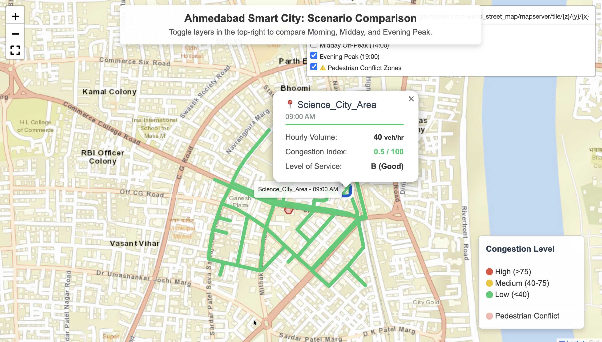
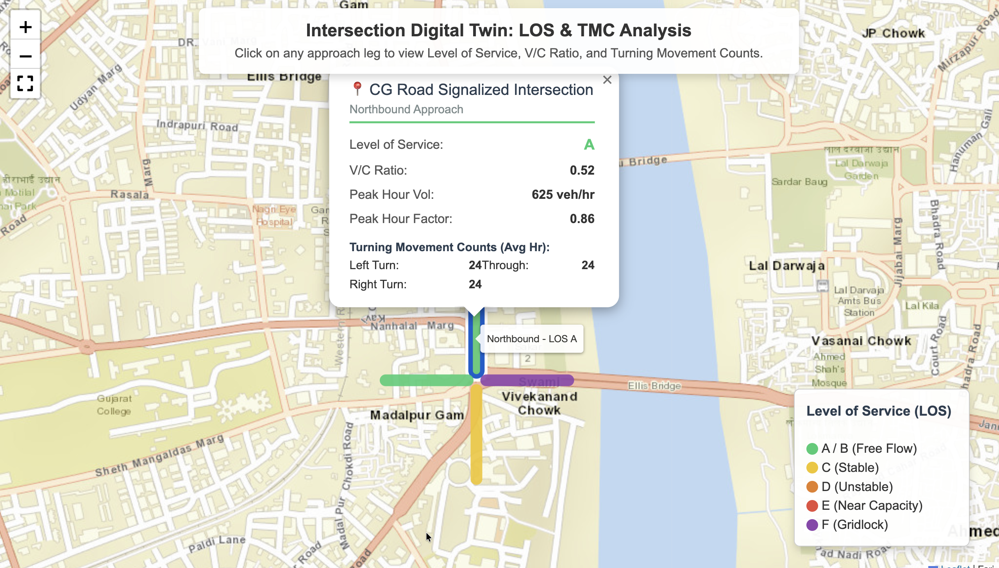

# Ahmedabad Smart City: Spatial Traffic Analytics & Intersection Digital Twin


## Project Overview

An end-to-end spatial data engineering pipeline that converts raw turning movement counts into interactive geospatial dashboards for urban intersection analysis. Calibrated for Ahmedabad, Gujarat, covering two real junction types: a 4-leg signalized intersection (CG Road area) and a 3-leg roundabout (Science City area).

The goal: intersection analysis in India still ends as static PDFs and Excel sheets. This project treats an intersection as a live, queryable data product.

## Live Interactive Dashboards

Click either dashboard to explore it directly in your browser.

### 1. Scenario Comparison Dashboard
[Open Live Dashboard](https://srivastavnilesh.github.io/spatial-traffic-intersection-analytics/outputs/scenario_traffic_dashboard.html)

- **Question answered:** Which time-of-day scenario is worst, and exactly where?
- **How it was built:** Three toggleable layer groups (Morning Peak 09:00, Midday 14:00, Evening Peak 19:00) over the real OSMnx street network. Every road segment carries a rich popup with hourly volume, congestion index, and Level of Service. Pedestrian conflict zones stay visible as a permanent overlay.
- **What it helps with:** Stakeholder decision meetings. Compare peak scenarios side by side without opening a spreadsheet or needing a live data feed.



### 2. Intersection Digital Twin (Flagship Deliverable)
[Open Live Dashboard](https://srivastavnilesh.github.io/spatial-traffic-intersection-analytics/outputs/intersection_digital_twin.html)

- **Question answered:** What are the engineering design parameters for each approach leg?
- **How it was built:** Approach-level geometric model combined with Highway Capacity Manual style metrics: Level of Service (A to F), Volume-to-Capacity ratio, Peak Hour Factor, and Turning Movement Counts per approach.
- **What it helps with:** Real design decisions. In the synthetic run, Eastbound approaches operate at LOS F (V/C 1.11) during peak hour while Westbound flows freely at LOS A (V/C 0.39). That single contrast justifies a dedicated turn lane or signal retiming.



## How the Two Fit Together

The pair works as a funnel:

1. **Scenario dashboard:** city-level screening. Where and when does congestion appear across the day?
2. **Digital twin:** approach-level engineering. Why is that approach failing, and what are the exact parameters to fix it?

## Pipeline Architecture

1. **Synthetic TMC generation** (`src/synthetic_traffic_generator.py`): 7 days of hourly turning movement counts across vehicle classes (2W, 3W, 4W, HMV) plus pedestrian volumes, with Ahmedabad-specific morning and evening peak profiles and night-time heavy vehicle patterns.
2. **Real-world geometry fetch** (`src/spatial_network_fetcher.py`): OSMnx street network download plus UTM-projected (EPSG:32643) 15-meter pedestrian conflict buffers.
3. **Spatial join and metrics** (`src/spatial_traffic_join.py`, `src/traffic_engineering_engine.py`): distance-aware joins, hourly aggregation, and LOS, V/C, and PHF calculations per approach leg.
4. **Visualization layer** (`src/interactive_map_builder.py`, `src/digital_twin_map_builder.py`): Folium dashboards with layer control, interactive popups, legends, and fullscreen presentation mode.

## Tech Stack

- **Data processing:** pandas, numpy
- **Spatial engineering:** geopandas, osmnx, shapely
- **Visualization:** folium
- **Workflow:** Git, GitHub, GitHub Pages, virtual environments

## How to Run

1. Clone and enter the repository:
   ```bash
   git clone https://github.com/YOUR_USERNAME/spatial-traffic-intersection-analytics.git
   cd spatial-traffic-intersection-analytics
